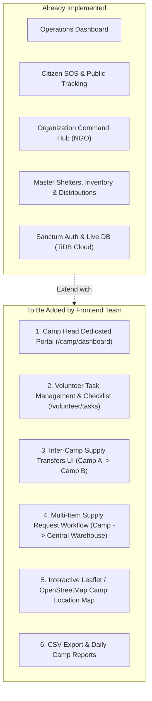

# Disaster Relief Management System (DRMS)
## Frontend Team Handoff & Implementation Guide

> **Notice for Frontend Team:**  
> The React 19 + Tailwind CSS frontend and Laravel 13 backend are **already initialized, operational, and connected to TiDB Cloud & Wasmer Edge**.  
> **DO NOT** delete `resources/js/`, recreate the Vite project, or start from scratch. Your task is to **extend existing views and add the remaining modules** detailed below.

---

## 1. What ALREADY EXISTS in the Project

The application already has a fully functional core architecture, database, API client, and 11 complete React views:

### A. Infrastructure & Live Endpoints
- **Live Deployment:** [https://webapp.wasmer.app/](https://webapp.wasmer.app/)
- **Live Login Portal:** [https://webapp.wasmer.app/login](https://webapp.wasmer.app/login)
- **Database:** TiDB Cloud Serverless MySQL (Port 4000 over TLS/SSL)
- **Backend Engine:** Laravel 13 (PHP 8.5 WASI running on Wasmer Edge via `server.php`)
- **Frontend Stack:** React 19, Vite, Tailwind CSS, Lucide React (Pure JavaScript/JSX — **NO TypeScript**)
- **API Service Layer:** `resources/js/api.js` (Handles Bearer JWT tokens via `localStorage`)

### B. Existing Database Tables & API Endpoints
| Feature | Table in DB | Existing API Endpoint | Description |
| :--- | :--- | :--- | :--- |
| **Authentication** | `users` | `POST /api/login`, `GET /api/me` | Role-based authentication (`admin`, `organization`) with Sanctum token. |
| **Camps / Shelters** | `shelters` | `GET /api/shelters`, `POST /api/shelters` | Relief camps (name, capacity, current occupancy, status, contact info). |
| **Citizen SOS** | `emergency_requests` | `GET/POST /api/emergency-requests` | Public SOS distress calls with GPS coordinates & tracking code (`REQ-XXXXXXXX`). |
| **Organizations** | `organizations` | `GET /api/organizations` | Relief NGOs (e.g. Red Cross Hub, hospitals, district triage units). |
| **Supplies & Inventory** | `resources` | `GET/POST /api/resources` | Warehoused items (food rations, water purifiers, medical kits, blankets). |
| **Distributions** | `distributions` | `GET/POST /api/distributions` | Aid disbursement records linked to events, shelters, and recipients. |
| **Volunteers** | `volunteers` | `GET/POST /api/volunteers` | Registered responder pool with availability toggles and skill sets. |
| **Incident Reports** | `incident_reports` | `GET/POST /api/incident-reports` | Field damage assessments and casualty logs. |
| **Disaster Events** | `disaster_events` | `GET/POST /api/disaster-events` | Active disaster declarations (cyclones, floods, earthquakes). |

### C. Existing Frontend UI Views (`resources/js/components/`)
1. **`DashboardView.jsx`**: Platform-wide Operations Command Center with real-time KPI counters.
2. **`CitizenPortalView.jsx`**: Public Citizen SOS distress signal broadcaster with GPS auto-detection & live status tracking.
3. **`OrganizationDashboardView.jsx`**: NGO Portal (Red Cross) with warehouse stock, volunteer rosters, distribution logs, and shelter capacity requests.
4. **`SheltersView.jsx`**: Relief camp grid showing capacity badges, occupancy bars, and new camp modal.
5. **`EmergencyRequestsView.jsx`**: Emergency distress signal queue with triage priority filters and dispatch controls.
6. **`ResourcesView.jsx`**: Inventory catalog with category filtering, unit measurements, and stock addition modal.
7. **`DistributionsView.jsx`**: Searchable audit ledger of delivered supplies.
8. **`VolunteersView.jsx`**: Responder registry with contact details, skills, and availability toggles.
9. **`IncidentReportsView.jsx`**: Field damage log.
10. **`DisasterEventsView.jsx`**: Incident registry for active disasters.
11. **`LoginView.jsx`**: Clean login portal with 1-click Quick-Fill demo buttons for Admin and Red Cross Coordinator.
12. **`Sidebar.jsx` & `TopHeader.jsx`**: Left-side responsive navigation with desktop layout and mobile drawer.

---

## 2. What SHOULD BE ADDED (Remaining Deliverables)

To satisfy the full requirements of the Master Prompt, the frontend team should implement the following extensions:



### Module 1: Dedicated Camp Head Portal
- **Concept:** Camp Heads must only see and manage their **own assigned camp/shelter**.
- **Pages to add/route:**
  - `/camp/dashboard`: Summary of the Camp Head's specific shelter (beneficiary count, current occupancy vs capacity, assigned volunteers, local inventory, active tasks).
  - `/camp/inventory`: Local camp stock balances, consumption logs, and shortage reporting.
  - `/camp/daily-report`: Daily headcount, supplies received/distributed, and incident remarks.

### Module 2: Volunteer Task Management System
- **Concept:** Camp Heads assign tasks; volunteers acknowledge, update, and complete tasks on mobile.
- **Workflow:** `PENDING -> IN_PROGRESS -> COMPLETED`.
- **UI to build:**
  - Camp Head task assignment modal (Task title, volunteer dropdown, deadline, priority, category).
  - Volunteer Task Checklist view (Mobile-friendly cards with "Start Task", "Mark Completed", and "Report Blocker" buttons).

### Module 3: Inter-Camp Supply Transfers
- **Concept:** When Camp A has surplus water and Camp B has a critical shortage, the Admin authorizes a stock transfer.
- **UI to build:**
  - Transfer Initiation Modal: Select Source Camp, Destination Camp, Item, and Quantity.
  - Status Timeline: `AUTHORIZED -> DISPATCHED -> RECEIVED`.
  - Destination Camp Head "Confirm Receipt" button to reconcile stock.

### Module 4: Multi-Item Supply Request Workflow
- **Concept:** Camp Head submits a request for supplies from the central warehouse.
- **Status Progression:** `PENDING REVIEW -> APPROVED / REJECTED -> DISPATCHED -> RECEIVED`.
- **UI to build:**
  - Multi-row request form (Item, Requested Qty, Urgency: Low/Medium/High/Critical, Reason).
  - Admin Approval / Rejection modal with dispatch quantity inputs.

### Module 5: Interactive Camp Location Map
- **Technology:** `leaflet` and `react-leaflet` with OpenStreetMap tiles (100% free, no Google Maps API key required).
- **UI to build:**
  - Interactive map inside `DashboardView.jsx` and `SheltersView.jsx` plotting shelter coordinates with colored pins based on occupancy (`Green` = Available, `Red` = Full/Overcrowded).

### Module 6: Daily Camp Reports & CSV Export
- **Feature:** "Export CSV" buttons on DataTables (`Shelters`, `Resources`, `Distributions`).
- **Implementation:** Standard client-side CSV blob generation from current table data.

---

## 3. Strict Development Rules for the Team

1. **NO TypeScript:** Do not create `.ts` or `.tsx` files. Use standard ES6+ JavaScript (`.js` and `.jsx`).
2. **NO Next.js or Node backend:** The backend is PHP Laravel 13 running on Wasmer Edge.
3. **Use Existing API Wrapper:** Import and extend `resources/js/api.js` for all backend requests.
4. **Preserve Citizen SOS:** Do not merge Citizen SOS into the Organization or Admin screens; it must remain an independent, zero-login public emergency service.
5. **Asset Sync Invariant:** Wasmer Edge serves the frontend from `public/`. Whenever you rebuild from the project root:
   ```powershell
   npm run build
   ```
   *(Or run the root script: `.\build-fullstack.ps1`, which validates `public/index.html` and `public/assets/`)*

---

## 4. Quick-Start Instructions for Frontend Developers

```bash
# 1. From the project root, install dependencies
npm install

# 2. Start Vite Dev Server with hot-reload (proxies /api to http://localhost:8000)
npm run dev
# Open http://localhost:3000 in browser

# 3. Production Build & Fullstack Verification
npm run build
.\build-fullstack.ps1
```

---

## 5. Demo Test Accounts

| Role | Email | Password | Access Scope |
| :--- | :--- | :--- | :--- |
| **System Admin** | `admin@disaster-relief.org` | `Admin@123` | Full command access, all shelters & central supplies |
| **Organization Coord** | `coordinator@redcross.org` | `Redcross@123` | Scoped NGO relief hub (Red Cross District) |
| **Lead Admin** | `spoorhisr@gmail.com` | `Admin@123` | Full administrative control |
